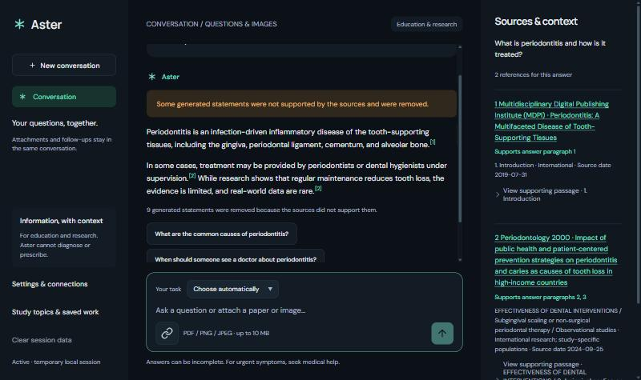

<p align="center">
  
</p>

# Aster — local medical information and study assistant

Aster runs entirely on your Windows PC. You can:

- ask health, medicine, dental and MBBS/MDS study questions and get answers with sources;
- photograph or scan a prescription and get help reading it;
- get research-model checks on adult chest X-rays.

After the first setup it works **offline**. You don't need an account, an API key, Python, Ollama or any other software,
and you don't need a graphics card.

> **Aster is for education and information. It does not diagnose, prescribe, choose or change medicines, or calculate
> personal doses. X-ray results are research scores for a clinician or radiologist to review, not a diagnosis.**
> It has not been clinically validated or reviewed by dental faculty. Version 0.2.0 is a **release candidate**.

<p align="center">
  
</p>

## Install and start (one click)

1. On [the repository page](https://github.com/AyushM1701/ASTER-AI), choose **Code → Download ZIP**.
2. Right-click the ZIP and choose **Extract All**. Don't run Aster from inside the ZIP.
3. Double-click **`Start Aster.cmd`** in the extracted folder.
4. The first time, Aster shows what it will download and asks you to continue. It then downloads its verified setup
   program, which installs everything automatically:
   - the local AI model and its runtime;
   - the text reader for prescriptions;
   - the X-ray checker;
   - the signed medical reference library.
5. When setup finishes, Aster starts. A small Aster window shows progress, and your browser opens the workspace once
   every startup check has passed.

**Starting Aster again:** use the **Start menu** or **desktop** shortcut, or run `Start Aster.cmd` again. No internet is
needed.

**Other ways to install:**
- **Installer only:** download `AsterSetup-Windows-x64.exe` from
  [Releases](https://github.com/AyushM1701/ASTER-AI/releases) and run it.
- **No internet on the target PC:** on another computer, download every file of the release into one folder. Then, on
  the target PC, run `AsterSetup-Windows-x64.exe --offline-dir "<that folder>"`.

### Windows warnings on first run

Aster isn't code-signed yet, so Windows may warn you once:
- **"Open File – Security Warning"** for `Start Aster.cmd`: choose **Run**.
- **"Windows protected your PC"** (SmartScreen) for the setup program: choose **More info → Run anyway**.

Setup only installs a file after checking its SHA-256 fingerprint against the signed list built into Aster. A modified
or corrupted download is deleted and never run.

## System requirements

| | Minimum | Recommended | Measured on |
|---|---|---|---|
| Operating system | Windows 10 or 11, 64-bit (x64) | Windows 11 | Windows 11 |
| Processor | Any 64-bit Intel or AMD processor | 6 or more cores | Intel Core i5-13450HX (10 cores) |
| Memory (RAM) | 8 GB (untested; expect slow answers) | **16 GB** | 24 GB. Aster used about 7.2 GB while running |
| Free disk space | **7.2 GB** (standard profile) | 10 GB or more | 3.8 GB once installed |
| Internet | Only for the first setup: about 2.9 GB | | |
| Graphics card | **Not needed.** Aster runs on the CPU only | — | Not used |

ARM-based Windows PCs are not supported. No administrator rights are needed: Aster installs into your user account
(`%LOCALAPPDATA%\Programs\Aster`) and keeps its logs and caches in `%LOCALAPPDATA%\Aster`.

### Performance profiles

Both profiles run entirely on the CPU. A graphics card is never used, so Aster behaves the same on any 64-bit PC.
**Standard** is the default.

| Profile | Used when | Download | Disk space needed | Answer time (measured) |
|---|---|---|---|---|
| **Standard** (default) | Any 64-bit PC | 2.9 GB | 7.2 GB | Median 32 s; 90% within 57 s |
| Quality CPU (manual) | 16 GB RAM or more, if you can wait | 5.5 GB | 12.4 GB | Not timed; slower than Standard |

These times were measured on the computer in the table above. Other hardware hasn't been tested, so no minimum
specification is guaranteed. Depending on your connection, the first setup takes roughly 15 minutes to over an hour,
and downloads resume if interrupted.

## Using Aster

- **Ask anything.** Everyday questions get a normal conversational answer, labelled as coming from the model's own
  knowledge. Health, medicine and dental questions are answered from Aster's medical library:
  - every statement shows its source number;
  - each statement is checked automatically against the passage it cites, and unsupported statements are removed;
  - if the library doesn't cover part of your question, Aster says so instead of guessing.
- **Choose a mode:**
  - **Understand** gives plain explanations for patients and families.
  - **Study & practise** gives postgraduate-level explanations, exam answers, MCQs and viva practice for MBBS and all
    nine MDS specialties.
  - **Research & Write** gives study designs, evidence strength and limitations.

  Follow-up questions ("how is it treated?") use the earlier topic.
- **Statistics:** for example, "Calculate sensitivity and specificity from TP 90, FN 10, FP 20, TN 180". Aster's
  checked formulas do the arithmetic, not the AI model, and they show the steps and assumptions.
- **Prescriptions:** attach a photo or scanned PDF.
  - Aster rotates the page if needed, warns about blurred or dark photos, and reads printed text. Handwriting reading
    is **experimental**.
  - Each field (medicine, strength, form, written dose, route, frequency, duration, instructions) is shown beside the
    matching part of the image. Anything unreadable is left blank, never guessed.
  - Confirm or correct the fields first; editing invalidates an earlier confirmation.
  - Aster then explains what the medicine is generally used for, citing US product labels. Your prescriber's written
    instructions are repeated exactly as confirmed, never changed or judged. Brand names are not matched to
    ingredients automatically.
- **X-rays:** attach an image and confirm it is an adult's chest X-ray.
  - Automated checks decline side views, dental, limb, CT/MRI images and photos, as far as they were evaluated.
  - Supported images get research scores for three findings, with explanations. A low score does not mean the X-ray
    is normal.
  - See [the X-ray evaluation](docs/release-readiness/XRAY_EVALUATION.md).
- **My Library:** add your own notes, articles or
  textbooks (PDF, including scanned pages, Word, text or Markdown; up to 100 MB). Aster indexes them on your PC and
  cites them by page in later answers. Ask "according to my notes…" to answer from your documents only. Aster does
  not review what you add, and says so on every answer that uses it.
- **Library updates:** **Connections & included data → Check for library updates** downloads newer signed library
  packs, only when you ask. Your questions and documents are never sent.

## Privacy

- Questions, documents and X-rays are processed on your PC and kept only in a temporary session.
  Documents you add to My Library are the exception: their extracted text stays on your PC until you remove them
  (the original file is not kept).
- Logs record states, never questions or images. There is no telemetry.
- Aster contacts the internet in three cases only:
  - during setup;
  - when you confirm a public literature search (Europe PMC);
  - when you ask for a library update.
- Its services listen only on your own computer (127.0.0.1).

## If something goes wrong

| Problem | What to do |
|---|---|
| `Start Aster.cmd` closes at once or says files are missing | Extract the whole ZIP first (**Extract All**) and run it from the extracted folder. |
| The download stops or fails | Run `Start Aster.cmd` again: the download resumes where it stopped. |
| "Not enough free disk space" | Free the amount shown (7.2 GB for the standard profile), or run `AsterSetup-Windows-x64.exe` from Releases and use **Change folder** to install on another drive. |
| Aster's window reports a problem | It shows a plain message and the next step for each problem: a damaged installation, a busy port (Aster picks another automatically), low memory or disk, or a model that failed to start. |
| Something seems damaged | **Repair Aster** (Start menu) re-checks every file and re-downloads anything damaged. |

- **Uninstall:** use **Uninstall Aster** (Start menu, or Windows **Installed apps**). You can choose whether to remove
  downloads and saved notes too.
- **Previous version:** a newer version keeps the previous one, so you can return to it with
  `AsterSetup-Windows-x64.exe --rollback`. This is untested in this release candidate.

## Medical library

The library is built automatically from openly licensed sources, and each source's licence and attribution are kept:

| Source | Licence |
|---|---|
| MedlinePlus health-topic summaries and medical-test pages | Public domain |
| US drug labels, via openFDA | CC0 |
| Open-access articles from Europe PMC/PMC: reviews, guidelines and systematic reviews across all nine MDS specialties, shared sciences and general medicine | CC BY, CC BY-SA, CC0 |
| OpenStax textbooks, in an optional noncommercial pack | CC BY-NC(-SA) |
| Aster's earlier curated MBBS/MDS sources | Per source |

Collection details, counts and gaps per specialty are in the
[coverage report](docs/release-readiness/LIBRARY_REPORT.md). Coverage is not exhaustive: some topics are thin, and
Aster reports those gaps. US drug labels describe US products and do not establish equivalence with Indian brands.

## Evaluation and status

- **Measurements.** The [acceptance report](docs/release-readiness/ACCEPTANCE_REPORT.md) records what was measured, on
  which build, and what remains. Highlights:
  - all 30 checks on the packaged app passed, including four for My Library;
  - held-out answer behaviour was 93% with the Standard profile (and 98% with the larger 4B model, measured on a GPU for the evaluation only), on questions and expected answers written by AI, not by
    clinicians;
  - prescription handwriting was tested on synthetic handwriting fonts only.
- **Still needed before a stable public release:**
  - testing on a clean machine;
  - code signing;
  - independent clinical and faculty review;
  - evaluation on real handwriting and radiologist-labelled X-rays.

## For developers

To run from source, use the library pipeline, run tests and evaluations, or build a release, see
[docs/DEVELOPMENT.md](docs/DEVELOPMENT.md).

```text
Start Aster.cmd          one-click start for the downloaded source ZIP
tools/bootstrap/         downloads the pinned, verified setup (used by Start Aster.cmd)
release/                 trust roots: signed release lock and the pinned setup fingerprint
backend/app/             FastAPI service: grounded answers, claim checking, prescriptions, X-ray, policy
frontend/                local web workspace (frontend/web) and its same-origin bridge
aster_library/           builds, signs and indexes the reference library packs
aster_release/           setup engine, launcher and packaged acceptance tests
packaging/               PyInstaller specs, release builder, notices and asset rights
evaluation/              frozen evaluation set, runners and scorers (answers, X-ray, handwriting)
configs/                 library plans, models, policy, X-ray gates, release public key
scripts/, research/      earlier curriculum and reference-pack tooling (still used by tests)
tests/                   regression suite (pytest)
docs/                    development guide, release readiness, history and earlier reports
tools/dev/               source-checkout helpers (environment setup, model runtime, start)
```

Earlier project documentation: [docs/history/README-2026-10-11.md](docs/history/README-2026-10-11.md).

## Licence

Aster's code is [MIT licensed](LICENSE). Models, runtimes and library content keep their own licences; see
[THIRD_PARTY_NOTICES.md](THIRD_PARTY_NOTICES.md).
