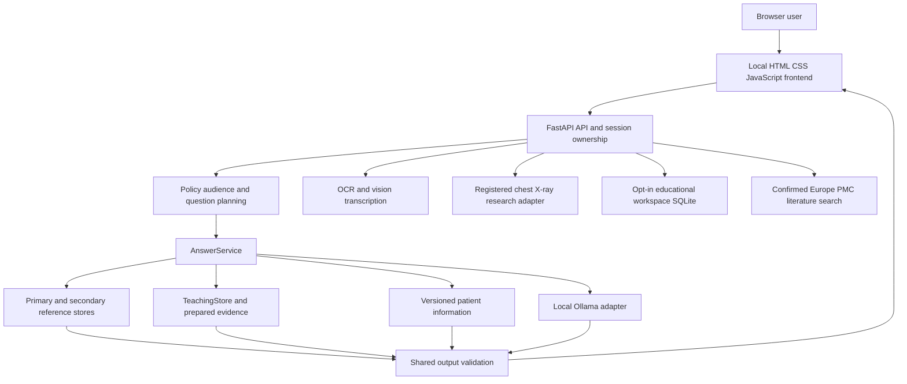

# Aster architecture and knowledge snapshot

Snapshot: 13 October 2026. The accompanying root file `Architecture and Source.md` contains the source and readable knowledge snapshot. `architecture-source-inventory.jsonl` accounts for every discovered workspace file, including omitted files. The large archive is the historical snapshot created before the master implementation changes; this architecture document also records later extensions. These documents describe recorded workspace states; they do not activate a source pack or certify medical correctness.

## Reading the archive

The archive embeds complete readable application files, tests, scripts, configuration templates, documentation, normalized knowledge, source packs, public-source review records and evaluation artifacts. Each embedded file has its original relative path, byte count, SHA-256, encoding and line count. Fences grow when source text contains Markdown fences. The inventory records payload offsets for verification without loading the entire archive into memory.

Credentials, private educational workspaces and temporary runtime records have no embedded content. Dependency installations, caches and generated executable distributions have inventory entries rather than repeated source. Binary models, images, PDFs and numerical indexes have file identities and hashes where applicable. Raw acquisition files have inventory entries; the archive embeds their normalized/extracted derivatives and rights records where available. Individual source notices and reuse restrictions still apply. This is a local inspection artifact, not a redistribution licence or a runnable backup.

Only files under this workspace enter the snapshot. External model caches, environment variables, machine services and the general knowledge encoded in pretrained model weights cannot be exported as readable medical facts. Aster has no newly trained all-MDS model. The collector's RAG and evaluation sets remain separate.

## Process architecture

The development installation uses loopback services: frontend port 8501, API port 8000 and Ollama port 11434. Installed profile values can override defaults. `backend/app/config.py` defines validated settings; `configs/teaching.env` and private `.env` supply the local profile. This archive omits private environment files but includes `.env.example` and safe public configuration.

`backend/app/main.py` constructs services during FastAPI lifespan. It creates the session and workspace stores, compute gate, retrieval stores, Ollama/OCR adapters, AnswerService and XrayService. Periodic cleanup expires sessions; shutdown closes clients and removes temporary sessions. Request middleware adds request identifiers and enforces bounded request sizes. API modules handle chat, attachments, documents, education, sessions and X-rays.

The frontend is plain HTML/CSS/JavaScript in `frontend/web`, served by `frontend/webserver.py`. It displays evidence, citations, coverage, comparisons, study attempts, research drafts and image review. Medical text uses safe DOM rendering. Local font and icon assets retain their own licences. Other frontend files remain in the source snapshot as present; the archive does not assume every historical entry point runs in the current installation.

## Answer and evidence contracts

`question_plan.py` identifies audience, topic, requested facets, entities, scope and follow-up context. `mds_curriculum.py` holds the canonical runtime vocabulary. Generic planning supports multipart educational questions, comparison of up to six entities, fictional study cases, viva prompts and progressive explanations. Personal symptom questions follow the patient contract.

`evidence_plan.py` retrieves candidates and applies facet/scope and source-hold restrictions. Retrieval can use lexical search or local MiniLM embeddings with exact NumPy indexes. Primary, secondary and teaching libraries have separate stores and versioned identities. Similar product names, strengths, routes and formulations are not automatically interchangeable.

`prepared_evidence.py` checks trusted explanation identities, exact prepared-text hashes, parent source hashes, applicable facet bindings and whole qualifications. An explanation-only hold permits only its specifically named prepared units. Held raw wording stays excluded. AI inspection does not establish faculty or clinical review.

`answer_composer.py` assembles source-bound claims, sections and comparison cells within a bounded answer budget. `output_validation.py` applies the common terminal guard: citations must resolve, source identity and coordinates must match, and displayed claims must satisfy the actual requested facets. Model-declared coverage cannot override evidence gaps. The runtime reports complete, partial or insufficient evidence according to the contract.

`progression.py` preserves topic context and avoids exact repeats of whole prior claims. `viva.py` manages temporary question/answer state. Its lexical feedback remains provisional; it does not provide validated postgraduate semantic grading. Starting a viva without substantive medical claims is not a complete medical explanation.

Ollama supplies local inference and experimental image transcription. The configured development model described in project documentation is `qwen3-vl:2b-instruct`; settings defaults may differ. Strict grounding and fallback checks limit source-backed medical output. Pretrained knowledge is not an audited local citation collection.

## Medical knowledge and coverage

Counts below come from existing project reports and the frozen evaluation. The embedded release manifests and records provide the underlying data. These are installation/report facts, not claims that every requested question can be answered.

| Collection or contract | Recorded scope and status |
| --- | --- |
| Primary reference release | `aster-v2-netmeds-r2-2026-10-07`, 266,870 sections |
| Secondary medicine collection | `aster-secondary-v1-r2-2026-10-07`, 6,670 notes linked to 3,408 products |
| Configured teaching release | `aster-teaching-all-mds-v3-2026-10-10`, 7,773 records from 404 source units, 43 prepared explanations and 118 source holds |
| Latest inactive candidate | `mds-generalization-candidate-v3-2026-10-12`, 7,786 whole records and 62 prepared explanations; active corpus/index configuration unchanged |
| Open-material collection | 120 documents: 110 RAG and 10 evaluation holdout, 7,407 spans; permissions and source rights retained separately |
| National MDS curriculum | 306 assessment items; official DCI 2017 material and cached amendment documents; current consolidated regulatory completeness remains pending |
| Editorial MDS topic map | 144 topics across nine specialties; canonical runtime topic registry covers 25 topics; topic declaration does not establish answer readiness |
| Patient information | 28 developer-written units bound to eight NHS snapshots; release expires 17 October 2026 |
| Patient pilot topics | Toothache, headache, fever, sore throat and abdominal pain; uncovered contexts may remain partial |
| Plain-text report terminology | Bounded hemoglobin/glucose explanations; no personal numeric interpretation or diagnosis |
| Chest imaging | Two registered NIH adult frontal chest research assets; arbitrary images cannot receive specialist scores |

The nine MDS specialty areas are Conservative Dentistry and Endodontics, Prosthodontics, Periodontology, Oral and Maxillofacial Surgery, Orthodontics, Pediatric Dentistry, Oral Medicine and Radiology, Oral Pathology, and Public Health Dentistry. Source registers, syllabus files and topic records contain their exact project labels and boundaries. User preference is the official national curriculum; no university overlay is asserted.

The original frozen 150-task oral-pathology pilot completed 0/150 tasks. A later inspected pack completed 38/150 in its separate development pilot; this does not replace the original result. Latest supplied-question evaluation has 107 cases and 111 turns. All 111 HTTP responses succeeded, but only 16 turns contain substantive claims and only 3 complete all requested facets with substantive claims. Eight raw complete statuses include viva starts without claims. Transport success and software test success do not imply medical coverage.

The supplied apoptosis explanation and simple-to-postgraduate follow-up have source-bound support. Many specialty mechanisms, diagnostic comparisons, treatment principles, fictional-case reasoning and current-evidence appraisal remain uncovered. `docs/MDS_GENERALIZATION_2026-10-13.md` and the frozen evaluation's `remaining-turn-gaps.json` identify these gaps. Faculty review and clinical readiness remain pending.

## Data directories and provenance

| Directory | Role |
| --- | --- |
| `configs` | Source/asset registers, curriculum, policies, benchmarks, release settings and permitted configuration templates |
| `data/references/normalized` | Seed records |
| `data/references/releases` | Versioned primary reference records and metadata |
| `data/references/secondary` | Product-linked secondary notes and manifests |
| `data/references/mbbs` and `data/references/mds` | Teaching releases, explanations, syllabuses, source records and staged collections |
| `data/references/mds/open_corpus` | Acquisition provenance, rights, extracted text, RAG chunks, holdout and collection reports |
| `data/references/patient` | Patient source snapshots, prepared units and release metadata |
| `data/knowledge_v2` | Catalogue candidates, imports, identity crosswalks and audit data |
| `data/indexes` | Derived search metadata and binary arrays/databases |
| `data/models` | Downloaded embedding/model/runtime assets; weights are binary |
| `data/evaluation`, `data/samples`, `data/xray` | Benchmarks, synthetic examples and registered imaging research assets |
| `data/private`, `data/workspaces` | Private configuration backups and opt-in saved educational work; content omitted |
| `artifacts/source-packs`, `artifacts/source-review` | Inactive pack versions, inspection records, bindings, source hashes and admission decisions |
| `artifacts/evaluation` | Historical and current software/answer evaluations; each run retains its own version |
| `artifacts/checkpoints` | Prior source snapshots and prompt provenance; these are historical, not current entry points |
| `artifacts/release` | Generated Windows build/distribution artifacts; inventory only |

Versioned records contain source identity, text, citation coordinates and permission/review metadata. Manifests and checksums bind releases to their files. Prepared text has its own identity and parent hashes. Indexes derive from specific source versions; copying a candidate pack into an archive does not activate it or rebuild its index. Rights evidence, source holds, noncommercial/share-alike terms and third-party notices must accompany any permitted reuse.

Source units can be publisher pages, chapters or articles. Their counts do not represent independent textbooks or qualified medical review. Older releases and alternate candidates remain available on disk; archive inclusion does not mean the runtime reads all of them simultaneously. Evaluation holdout data is not training or runtime knowledge.

## Attachments, research and persistence

Prescription ingestion classifies image content, runs Tesseract and optionally local vision transcription, then requires confirmation of extracted fields. Difficult handwriting remains unreliable. X-ray processing uses registered source/weight manifests and research restrictions. Neither route establishes diagnosis or treatment advice.

Research & Write sends a confirmed public query to Europe PMC and builds a bounded literature table, editable scaffold and bibliography. Markdown, BibTeX and JSON exports retain source context. Manual appraisal, semantic verification and medical synthesis remain pending. User drafts and saved attempts live in a separate opt-in educational SQLite store; temporary patient session data is not that workspace.

## Packaging and development

`aster_release` implements distribution manifests, staging, installer/launcher, provisioning, model cache, process lifecycle, acceptance and smoke checks. `packaging` contains build specifications and release resources. Current generated ValidationOnly builds have separate publication gates and predate some source changes; the archive makes no public-release claim.

`scripts` contains acquisition, parsing, normalization, library/index preparation, permission audits, source-pack inspection, evaluation and release tooling. `tests` verifies behavior and boundaries. Requirements and lock files describe dependency choices; `.venv` contains an installed dependency environment rather than project-authored source.

Existing verification evidence records 1,018 passing regression tests before the final narrow apoptotic-pathway alias change, 18 affected planner tests after it, and JavaScript/rendering checks. Those are historical results included as evidence. Creating this documentation snapshot does not rerun the application suite or change medical functionality.

## Snapshot integrity and limits

The generator `scripts/export_architecture_source.py` walks the workspace deterministically, classifies every file, embeds readable eligible contents without truncation and writes an inventory. It omits its generated output files to prevent recursive growth. The report states totals, omissions, read errors and verification outcomes. Non-secret binary assets receive streaming SHA-256 checksums; dependency/cache/private files have explicit reasons when hashes are omitted.

The archive preserves original UTF-8 bytes inside source fences. Other supported text encodings convert to UTF-8 and retain original and payload hashes. Payload offsets distinguish real file bytes from Markdown separators. No line numbers are inserted into source text. Paths are relative to this workspace. Concurrently modified files and read failures are reported rather than silently treated as a frozen snapshot.

The file inventory includes credentials/private paths by name and size, without their content or hashes. The generated documents should remain local: normalized medical records can carry restrictive licences, and evaluation records can contain prompts. The snapshot is not a public source distribution, a model training dataset or a replacement for source permission review.

## Master implementation extensions

Production architecture remains intact. Subject/facet planning and privacy-safe diagnostics were repaired; an explicit candidate limit serves offline comparisons while the production default remains8. Prepared output discloses recorded AI source inspection separately from qualified human review. All staged packs remain inactive. Latest development source:7,789 records/410 source entries,63 prepared units/54 bound; its111-turn pilot produces18 substantive and4 complete substantive responses. Broad all-MDS readiness is unfinished.

The separate research namespace supplies governance/leakage/oracle/metric mechanics, an untrained FGRC reference, a frozen retrieval/guard runner and local blinded-review tools. Private reviewer declarations/token files are excluded from source checkpoints. No research model is deployed and no actual faculty assessment exists. See docs/implementation/execution_report.md and requirement_ledger.json for current scope and gates. The root Architecture and Source.md archive was not regenerated after these changes.

## Temporary private research papers

The source-runtime `/v1/papers` API shares existing session ownership and upload quotas. A resource-bounded local worker extracts PDF page text without raw-file persistence. Explicit private-analysis authorization and current-revision extraction confirmation precede exact, policy-checked section excerpts. The common finalizer requires out-of-band trusted paper context and validates PDF/page/span identities. Private text uses an uncached source predicate, stays outside shared indexes/training/education exports, and is invalidated on reopen, clear, expiry or deletion. The single-chat interface reuses existing review and evidence controls. This is partial appraisal; packaged PDF parsing and complete source-scoped synthesis remain unavailable. See `docs/implementation/private_paper_verification.md`.

Current inactive source candidate-v5 has7,791records/411source entries and65prepared/56bound units. Final111-turn same-code control remains18substantive/4complete; one comparison gains two qualified inflammation cells. Runtime association/list grammar and exact staged allowances were corrected. Final1103-test checkpoint is in artifacts/evaluation/master-2026-10-13/necrosis-planner-v5-final. The private-paper workflow remains partial appraisal and does not enter the shared source pack.
