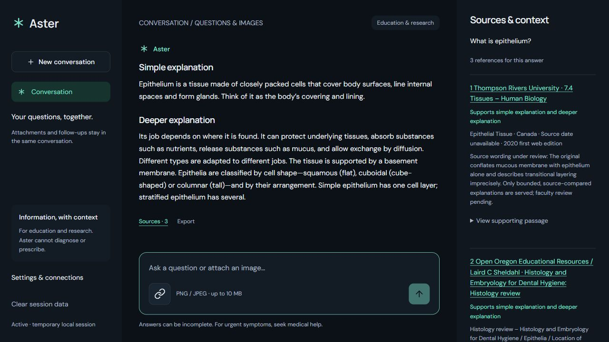
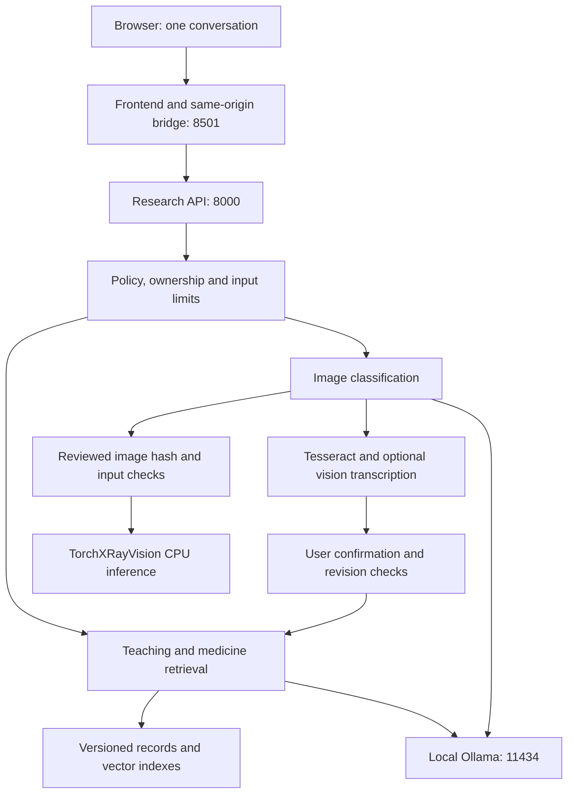

<p align="center">
  
</p>

# Aster Medical Research

Aster is a local medical education and research application. It brings questions, prescription images and registered chest X-rays into one conversation, searches versioned reference libraries, and keeps supporting sources beside the answer. The interface uses a dark ambient design, responsive navigation and locally hosted fonts and icons.

**Project snapshot: 11 October 2026.** This guide describes the code and the configured Windows development installation. A fresh checkout starts with fewer capabilities because downloaded models, indexes and private configuration are separate assets.

**Intended use: education and local research.** Aster does not establish a diagnosis, select a medicine for a person, calculate personal doses, change treatment, or confirm that an X-ray is normal. Faculty medical review remains pending; software tests do not establish clinical accuracy.

**Want to use Aster?** The Windows one-click release is being prepared for [GitHub Releases](https://github.com/AyushM1701/ASTER-AI/releases). Once a reviewed release is published, download `AsterSetup-Windows-x64.exe`: it installs a fixed, verified application and included model without Python, Ollama or Tesseract setup commands. Initial setup downloads archive parts; the installed app runs locally. The same setup program can assemble already downloaded parts offline. **No public installer is published by this implementation.** The local `ValidationOnly` portable build is an engineering artifact and must not be redistributed.

**Want to develop Aster?** Use the source installation instructions below. `setup.ps1`, `setup-chat.ps1` and `start.ps1` remain developer tools. See the [Windows release guide](WINDOWS_RELEASE.md) for build commands, integrity checks, editions, permissions, installation, repair, rollback and the acceptance matrix. Aster's own code is [MIT licensed](../../LICENSE); third-party assets keep separate terms.

**Current product workflows (11 October):** one chat offers automatic task selection, Understand, Study & practise and Research & Write. New features include the prepared-topic activity browser, opt-in persistent study attempts/revisit records, a bounded Europe PMC search with source-linked evidence table and editable review scaffold, Markdown/BibTeX/JSON exports, and separately tested hemoglobin/glucose report terminology. See the [product scope implementation and remaining gates](PRODUCT_SCOPE_IMPLEMENTATION_2026-10-11.md). Qualified medical review, real-user testing, comprehensive curriculum operation coverage and completed medical synthesis remain pending. The earlier frozen ValidationOnly package predates these changes.

**Start the new workflows:** use **Study topics & saved work** in the left navigation. Browsing topics requires no saving. To retain study attempts or research projects, explicitly enable local educational saving; it is separate from temporary patient sessions. Research queries require confirmation before going to Europe PMC. The project is saved locally until deleted. Choose **Record study attempt** below a student answer, or **Research & Write** to define a focused question and build a limited literature search. Edited drafts remain unverified; saving does not medically validate them.

**Interface refinement (11 October):** the composer is more compact, prepared topics can be filtered, and controls/dialogs provide consistent feedback with reduced-motion support. Draft loading/saving preserves project identity and newer edits; saved-work deletion uses confirmation and pending locks. [UI verification report](UI_INTERACTION_REFINEMENT_2026-10-11.md) records five JavaScript interaction tests, thirteen scoped Python tests and desktop/phone checks.

**F21 patient relevance:** ordinary symptom questions now use a separate, versioned patient-information collection and completion contract. Toothache, headache, fever, sore throat and abdominal pain receive plain explanations, possible causes, uncertainty, professional follow-up and warning signs where applicable evidence exists. Related postgraduate chapters cannot substitute for symptom guidance. Technical study questions retain the teaching workflow. This is a bounded local pilot, not independent clinical validation. See [F21 implementation, source rights and evaluation](F21_PATIENT_RELEVANCE.md).

The current patient release contains **28 developer-written explanation units bound to eight NHS source snapshots**, copied on 10 October 2026. It expires on **17 October 2026**; missing, modified or stale evidence disables this symptom pathway without falling back to model memory. These materials use separate NHS/Open Government Licence terms, not the code's MIT licence. Original source passages, dates and attribution appear in the evidence panel; Aster's adaptations are not NHS-approved advice. Pregnancy, medical history, combined symptoms and uncovered contexts may receive a partial response or an explicit limitation. Refreshing requires source and permission comparison; see the F21 report for the procedure.

**MDS evidence and open-material upgrade (11 October):** typed topic/facet planning, common output checks, source-bound sections/comparisons, temporary viva practice, national curriculum scope, reviewed inactive pack tooling and a bounded 120-document open-material collection are implemented. The installed-source pilot did **not** pass educational coverage: 0/150 core tasks completed under the new contract. The collection remains staged, independent clinical review is pending, and no release or active corpus/index import occurred. See the [implementation tracker and operating report](MDS_IMPLEMENTATION_2026-10-11.md), [evaluation](MDS_EVALUATION_2026-10-11.md), and [collection checkpoint](MDS_OPEN_CORPUS_2026-10-11.md).

## Contents

- [Windows release and one-click installation](WINDOWS_RELEASE.md)
- [Windows release evaluation and remaining publication gates](WINDOWS_RELEASE_EVALUATION.md)
- [Capabilities and current installation](#capabilities-and-current-installation)
- [Using Aster](#using-aster)
- [Installation and startup](#installation-and-startup)
- [Architecture](#architecture)
- [How answers work](#how-answers-work)
- [Simple and deeper explanations](#simple-and-deeper-explanations)
- [Knowledge libraries and curriculum](#knowledge-libraries-and-curriculum)
- [Medicines and Indian datasets](#medicines-and-indian-datasets)
- [Prescription reading and handwriting](#prescription-reading-and-handwriting)
- [Chest X-ray research](#chest-x-ray-research)
- [Models and hardware](#models-and-hardware)
- [Configuration](#configuration)
- [API and response states](#api-and-response-states)
- [Privacy and security](#privacy-and-security)
- [Evaluation results](#evaluation-results)
- [Testing and development](#testing-and-development)
- [Library updates and rollback](#library-updates-and-rollback)
- [Repository map](#repository-map)
- [Deployment](#deployment)
- [Troubleshooting](#troubleshooting)
- [Known gaps](#known-gaps)
- [Sources and licensing](#sources-and-licensing)
- [Further documentation](#further-documentation)

## Capabilities and current installation

| Capability | Behavior | Boundary |
| --- | --- | --- |
| Medical education | Retrieves source sections or a source-bound teaching explanation | Only the supported scope; many topics and complex questions remain uncovered |
| MBBS/MDS study | Searches a separate curriculum library with subject and research context | Incomplete coverage; no faculty accuracy certification or practical competency assessment |
| Study progress | Explicitly saved topics, attempts, weak concepts and revisit dates; export/delete | Self-assessment only; separate from patient documents, not validated grading |
| Research & Write | Confirmed public Europe PMC query, bibliography, quoted evidence, editable scaffold and Markdown/BibTeX/JSON exports | Limited single-provider search; manual screening, critical appraisal, medical synthesis and faculty review pending |
| Plain-text report glossary | Explains hemoglobin and glucose terminology, accounts for unsupported lines | No numeric interpretation, normality assessment, diagnosis or image lab-report ingestion |
| Medicine information | Resolves registered identities and applicable product details before retrieving sections | Similar names, strengths, routes and release formulations are not interchangeable |
| General conversation | Uses a local pretrained model for explicitly recognized nonmedical requests | Limited intent list, no local citations, no factual correctness guarantee |
| Prescription images | Classifies pixels, extracts English text and requests field review | Mandatory confirmation; difficult handwriting remains unreliable |
| Chest X-rays | Routes the image and scores a reviewed registered adult frontal chest asset | Research scores only; arbitrary X-rays cannot receive specialist scores |
| Evidence/export | Shows source passages and limitations beside answers; exports response JSON | Citation validity alone does not prove correctness |

These are the **configured development assets**, rather than defaults promised by `setup.ps1`:

| Component | Current installation |
| --- | --- |
| Frontend | HTML/CSS/JavaScript served by `frontend.webserver` on `127.0.0.1:8501` |
| Research API | FastAPI on `127.0.0.1:8000`, one worker |
| Inference server | Project-local Ollama on `127.0.0.1:11434` |
| Text/attachment vision | `qwen3-vl:2b-instruct` |
| Answer mode | `ollama`, strict source grounding and extractive fallback |
| Reference release | `aster-v2-netmeds-r2-2026-10-07`: 266,870 sections |
| Secondary medicine release | `aster-secondary-v1-r2-2026-10-07`: 6,670 notes linked to 3,408 products |
| Teaching release | `aster-teaching-all-mds-v3-2026-10-10`: 7,773 sections from 404 source units |
| Teaching notes/holds | 43 developer-reviewed explanations, 118 source-review holds |
| Search | Lexical plus MiniLM; separate exact NumPy reference/teaching indexes |
| OCR | Tesseract plus enabled experimental English vision transcription |
| Imaging | Enabled TorchXRayVision CPU adapter; two registered NIH demo assets |
| Latest code verification | 664 source regression tests passed (58.96s); the final local-date repair passed all 31 affected tests (7.77s). 35 patient/student probes and a ten-paper literature pilot with three permitted full texts; desktop/mobile and restart persistence checked. Engineering evidence, not clinical accuracy; earlier/frozen evidence recorded separately |

A source unit can be a publisher page, chapter or article; 404 units do not mean 404 independent books. A hold can exclude raw wording or allow only a bounded explanation. It is not clinician approval.



## Using Aster

### Questions and follow-ups

Type into **Message Aster**. `What is epithelium?` requests a general tissue explanation; `What is sulcular epithelium?` requests a particular gingival lining. Scope modifiers matter: `simple squamous epithelium` names a tissue type rather than merely requesting easier language.

Read **Simple explanation**, then **Deeper explanation**. **Sources** beneath an answer selects its references in the right panel; phones use a sources drawer. **Export** downloads JSON with original claims, citations, warnings and presentation layers.

`tell me more`, `explain that` and `what does that mean` reuse the previous resolved topic. They do not guarantee additional library content and may repeat the available explanation. Confirmed document context follows its separate revision checks.

### Prescriptions

Use the link icon beside the composer to attach a PNG/JPEG. The vision model examines pixels rather than deciding from the filename. A prescription classification starts OCR and field review. Compare every field with the original, leave missing or illegible values unresolved, acknowledge the comparison and choose **Confirm and explain**.

Editing invalidates the previous confirmation. Aster checks the current revision before explaining it, and confirmation represents the user's transcription review rather than clinical approval. **Settings & connections → Try a sample prescription** uses a synthetic image but still runs real classification and OCR.

### Registered X-rays

If acquired locally, attach `data/xray/nih-v3/00000001_000.png` or `00000002_000.png`. After classification, Aster matches the original file hash to its reviewed registration before specialist scoring. Resaving an image can change the hash and remove eligibility. Classification alone never supplies the required registration.

### Sessions and connection status

**Settings & connections → Refresh connections** checks component readiness. **New conversation** starts fresh; **Clear session data** deletes the current backend session. Page reload creates a new session rather than restoring old uploads. An abandoned session remains until expiry/cleanup, while an API restart loses all sessions.

## Installation and startup

### Existing Windows installation

```powershell
cd '<path to your Aster checkout>'
.\start.ps1
```

Open [Aster](http://127.0.0.1:8501/) or the [backend API documentation](http://127.0.0.1:8000/docs). The launcher starts API/frontend processes and starts project-local Ollama if its executable exists and port 11434 is free. `-NoBrowser` suppresses opening the browser. **Ctrl+C** in the launcher terminal stops services it started; a pre-existing Ollama server stays running. Occupied API/UI ports cause an error rather than terminating unrelated processes.

The frontend can become available before backend initialization finishes. Large libraries and cold model loading take time; UI liveness alone does not establish readiness.

### Fresh base installation

The declared Python range is **3.11–3.13**; the recorded Windows build used 3.13.3. Run commands from the project root:

```powershell
python --version
.\setup.ps1
.\start.ps1
```

`setup.ps1` creates `.venv`, installs `requirements.lock.txt`, checks package consistency, copies `.env.example` only when `.env` is missing, and runs asset verification. It does not download every model or rebuild expanded libraries.

The example profile uses extractive answers, lexical search and the small seed corpus. General chat, teaching, handwriting and imaging start disabled. Unified attachment classification needs a configured vision model even when Tesseract is installed.

`.gitignore` excludes model downloads, vector indexes, raw reference snapshots, private data and `.env`. A checkout therefore does not reproduce the installed research profile automatically. Release metadata may exist while a required index/checkpoint is missing.

### Shared text and vision model

```powershell
.\setup-chat.ps1
```

This explicit network setup downloads a checksum-checked Windows Ollama archive and pulls Qwen3-VL into the local model store. Earlier recorded archive/model sizes were approximately 1.5 GB and 1.9 GB; extraction, cache and other assets need additional disk space. This script does not run during a request or automatically rewrite model settings.

Edit `.env`, then restart:

```dotenv
ANSWER_MODE=ollama
TEXT_MODEL=qwen3-vl:2b-instruct
VISION_MODEL=qwen3-vl:2b-instruct
ENABLE_GENERAL_CHAT=true
```

`configs/models.yaml` records the observed digest. Repeating a model pull can acquire changed bytes, so verify and reevaluate changed models.

### OCR and optional dependencies

Install Tesseract with English language data using its [installation documentation](https://tesseract-ocr.github.io/tessdoc/Installation.html). The adapter checks `TESSERACT_CMD`, PATH, then the usual Windows location:

```dotenv
TESSERACT_CMD=C:/Program Files/Tesseract-OCR/tesseract.exe
ENABLE_HANDWRITING_OCR=false
```

Experimental handwriting additionally needs the local vision model and `ENABLE_HANDWRITING_OCR=true`; activation does not establish reliability.

`requirements-models.txt` and `requirements-teaching.txt` describe optional packages. Install a compatible matched PyTorch/torchvision pair first, as their comments direct. Observed extended Windows environments appear in `requirements-xray.lock.txt` and `requirements-knowledge-v2.lock.txt`; choose a profile rather than combining locks blindly. Acquire permitted releases/weights and build matching indexes before enabling their flags. Follow the linked library/model guides for full profile restoration.

### Manual startup and other platforms

If script execution prevents using the launcher, start services in separate terminals:

```powershell
# Terminal 1: API
.\.venv\Scripts\python.exe -m uvicorn backend.app.main:app --host 127.0.0.1 --port 8000 --workers 1 --no-access-log

# Terminal 2: frontend
.\.venv\Scripts\python.exe -m uvicorn frontend.webserver:app --host 127.0.0.1 --port 8501 --workers 1 --no-access-log
```

Manual launch does not start Ollama automatically. Run its configured loopback server separately when generation/vision is required.

On Linux/macOS, create `.venv` with `python3 -m venv .venv`, install the selected dependencies with `.venv/bin/python -m pip`, and replace Windows executable paths with `.venv/bin/python`. The PowerShell launcher, standalone runtime acquisition and default Tesseract path are Windows-specific. Full workflows and exact Windows locks still need a fresh compatibility check on another platform.

## Architecture



The browser loads static assets and calls `/api/...` on its frontend origin. `frontend/webserver.py` forwards allowlisted requests through server-side `httpx` to the fixed backend. The browser never calls Ollama or TorchXRayVision directly.

| Component | Responsibility | Address |
| --- | --- | --- |
| Frontend webserver | Static UI, synthetic sample and bounded bridge | `127.0.0.1:8501` |
| Research API | Sessions, policy, retrieval, OCR orchestration, imaging and validation | `127.0.0.1:8000` |
| Ollama | Local text generation, classification and vision transcription | `127.0.0.1:11434` |
| Tesseract | Bounded OCR subprocess | No HTTP listener |

MiniLM and imaging execute inside the backend process. A shared compute gate permits one expensive operation at a time with a bounded queue. Sources/indexes persist on disk; sessions stay in the single API worker's memory. There is no hosted database, Redis queue or cloud inference service.

The default UI needs no npm build, React runtime or Node installation. The earlier Streamlit interface remains in `frontend/app.py` as a legacy fallback; `start.ps1` launches the dedicated web frontend.

## How answers work

Policy checks run first. Recognized urgent wording returns direct guidance; personal diagnosis, medicine-selection and dosing requests receive a professional-review boundary. These deterministic language patterns are not validated triage.

The answer service routes `catalogue:`/`catalog:` lookups to the separate candidate catalogue. Explicit recognized nonmedical intents route before medical retrieval, preventing incidental immune-cell “programming” text from answering a computer-programming question. Eligible educational questions search the teaching collection; medicine questions enforce product identity, formulation and requested-section eligibility. Unsupported medical requests return insufficient evidence rather than unrestricted model-memory answers.

`ANSWER_MODE=extractive` returns eligible source notes. `ANSWER_MODE=ollama` requests structured claims from the local model and checks citations/output policy. Active strict grounding requires a generated medical claim to match a complete cited section after case/whitespace normalization, preserving qualifications and negation. Invalid, shortened or added wording can trigger an explicitly labelled extractive fallback under the configured rules.

Manually authored teaching notes use a separate exact source-hash/citation binding process. They enable clearer wording while arbitrary generated medical paraphrases remain disallowed. Developer source comparison and faculty review are separate statuses.

Answers retain source jurisdiction, date/version, type and applicable limitations. **Retrieval-augmented generation (RAG)** means retrieving references for answering; adding library material here does not retrain Qwen or change its weights. Aster does not browse the internet for each question.

## Simple and deeper explanations

Informational responses display **Simple explanation** followed by **Deeper explanation**, both open. The current 43 teaching notes have checked presentation boundaries that partition existing sentences without adding or discarding facts. Research qualifications stay visible before affected statements.

Original complete claims/citations remain in the response and JSON export. Presentation layers record claim indexes and citation IDs; changed text hashes or citation bindings prevent stale layouts from applying. Sources in the evidence panel identify the supported layers.

General model responses have separate introduction/deeper-detail fields, and both receive output-policy checks. Greetings/thanks stay brief. Urgent, confirmation, insufficient-evidence and error states remain direct.

When a topic lacks a checked plain-language introduction, Aster states that before displaying reference detail. Missing further depth also receives an explicit notice. The format does not create absent content; many raw technical passages still need reviewed explanations. See [the implementation report](../reports/ASTER_LAYERED_EXPLANATIONS.md).

## Knowledge libraries and curriculum

| Collection | Current size | Role |
| --- | ---: | --- |
| Curated reference v2 | 250 sections, 92 documents | 46 general topics; selected tests/imaging terms; 31 US labels; 12 Indian workflows; five Indian manufacturer product-information sets |
| Retailer expansion | 266,620 sections, 23,939 product entries | Exact-identity retailer descriptions, not manufacturer approval |
| Combined reference library | 266,870 sections, 24,031 source entries | Curated layer plus retailer information |
| Secondary medicine layer | 6,670 notes, 3,408 linked products | Explicitly unverified composition, uses and side-effect data |
| Candidate catalogue | 253,973 rows in the acquired A-Z snapshot | Separate name/composition lookup, not clinical evidence |
| MBBS/MDS teaching | 7,773 sections, 404 source units | Foundations, all nine dental specialties, statistics and selected research; 43 explanations, 118 holds |

The curated layer includes NLEM 2022 catalogue information for 384 names, with formulation extraction for 358. Membership does not establish indication, dose or brand equivalence.

Only the 250 curated sections enter the primary dense index; retailer entries use exact identity and lexical ranking. Teaching has a separate dense collection so thousands of product descriptions do not dominate physiology questions. MiniLM supplies 384-dimensional vectors at a pinned revision. The active vector store is exact NumPy search; `CHROMA_PATH` retains a historical name, and Chroma is not the active service.

**Lexical search** compares words, phrases and registered terminology. **Semantic search** encodes a question and reference text as numeric vectors, then compares their similarity, helping with differently worded questions. Hybrid search uses both while keeping identity and scope gates. Similar meaning does not establish that two medicine products are equivalent. A **chunk/section** is one retrievable source unit; a **snapshot** is a recorded version of acquired content, and a **hash** is a fingerprint used to detect changed bytes.

### Curriculum scope

The 10 October all-specialty MDS expansion adds **203 openly licensed reviews and 4,857 research sections**, bringing the composed teaching library to **7,773 sections**. It includes material associated with Orthodontics, Conservative Dentistry/Endodontics, Oral and Maxillofacial Surgery, Prosthodontics, Periodontology, Oral Medicine/Radiology, Paediatric Dentistry, Oral Pathology/Microbiology and Public Health Dentistry. The existing MBBS material, 43 prepared explanations and 117 source holds are preserved; one additional dentin classification unit is withheld pending review.

See the [all-MDS expansion report](../reports/ALL_MDS_LIBRARY.md) and [topic-by-topic study material register](../reports/MDS_STUDY_MATERIAL_REGISTER.md). The new map has 126 editorial topics; 108 have newly imported, title-anchored article associations. This does not establish complete official curriculum coverage. Expanding retrieval does not fine-tune the model or guarantee an answer to every postgraduate question. Independent medical accuracy and completeness remain unscored.

The audit inventory contains 2,626 numbered MBBS competencies across 19 subjects, 116 supplemental objectives and 306 MDS Oral and Maxillofacial Pathology and Oral Microbiology items. It preserves 89 photographed topics; two supplied images duplicated a page. Uncertain handwriting and extraction discrepancies remain documented.

Teaching material covers foundations in anatomy/histology, physiology, biochemistry, pathology, microbiology, immunology, pharmacology and epidemiology, plus parts of clinical subjects. Dental material includes oral tissues, tooth development, periodontal structures, salivary glands, craniofacial development, oral microorganisms, laboratory techniques and biostatistics. Research records retain design, context and limitations; a patient series does not become general treatment guidance.

An inventory map does not prove teachable coverage or competency. The broad evaluation still found major gaps, especially for complex questions. Written questions cannot establish practical, clinical or laboratory skill.

### Releases and indexes

Releases retain normalized records, source registers, metadata and manifests binding snapshots, permissions, hashes, holds and checked notes. Index manifests bind vectors to the record snapshot and embedding revision. Incompatible or changed assets fail checks instead of silently mixing versions.

The current teaching lineage preserves earlier MBBS/combined MDS releases, adds foundation/review contexts and the epithelium correction, and leaves earlier releases for comparison/rollback. Historical reports describe their own release, not necessarily today's configuration.

## Medicines and Indian datasets

`drowsyng/medicines-dataset` supplies the 23,939 retailer entries. Its recorded dataset licence is Apache 2.0; the import preserves the user's verification/licensing attestation. The project has not independently validated every description as current manufacturer prescribing information.

`shudhanshusingh/az-medicine-dataset-of-india` and `dmedhi/indian-medicines` supply the secondary layer. Crosswalks admit a narrow subset after checking name-specific links, ambiguity, reported composition and conflicts against pinned snapshots. The resulting notes link to 3,408 retailer products; they are not interchangeable lists of clinically verified medicines.

Secondary notes can supplement eligible composition, purpose or side-effect questions, with a caution for unverified data. They cannot fill dosing, warning, contraindication or interaction sections. A link does not establish a manufacturer alias, substitution or complete ingredient list.

Identity checks retain ingredient, brand, strength, route, form and release variants. Unknown suffixes and unhandled concentrations remain unresolved. Fuzzy matches and catalogue names never silently repair OCR medicine text.

`catalogue: Ascoril LS Syrup` requests candidate catalogue information. An ordinary question about that product follows reference eligibility rules and may receive insufficient evidence for an unsupported section. The prefix does not convert a listing into prescribing guidance.

See [retailer integration](../reports/NETMEDS_CLINICAL_LIBRARY.md), [crosswalk](../reports/MEDICINE_DATASET_CROSSWALK.md), [secondary behavior](../reports/SECONDARY_MEDICINE_DATA.md), [Kaggle audit](../reports/DROWSYNG_MEDICINES_DATASET_AUDIT.md) and [Hugging Face audit](../reports/HF_INDIAN_MEDICINES_AUDIT.md).

## Prescription reading and handwriting

Uploads undergo byte, format, pixel and session-memory checks. The classifier returns `prescription`, `xray`, `other` or `uncertain`. In the unified attachment path, prescription classification starts extraction.

Tesseract uses English and page-segmentation mode 6, returning text/word boxes with engine scores. Those scores are not medicine-correctness probabilities. Optional vision transcription examines the same image; printed-style agreement/disagreement and uncertainty determine which result appears. Explicit uncertainty replaces affected lines with `[unreadable]`. A failed vision reader falls back to printed OCR with a warning.

The parser extracts medicine name, strength, formulation, route, frequency, duration and instructions when the text supports them. Documents carry revision/confirmation state, and edits invalidate explanations. Confirmation only records the user's comparison; an applicable reference still needs an exact product match.

### Measured handwriting limit

The saved development probe tested **37 English medicine-word crops**, not representative complete doctor prescriptions. Hybrid transcription read **10/37 words exactly**, with **27 wrong readings not marked unreadable**. Tesseract alone read 2/37 exactly. One clear synthetic printed sample had zero character/word errors and seven exact critical fields; seven synthetic scan variants passed their bounded checks.

Aster cannot safely recover illegible writing by selecting a nearby medicine name. Obtain a clearer scan or original digital prescription, keep uncertain fields unresolved and ask the prescriber/pharmacist for clarification. Dictionary matches and two readers agreeing do not establish the intended medicine.

Improvement requires permitted representative full prescriptions, independently verified transcriptions, field-level error measures and assessment of wrong readings that escape abstention. [The evaluation report](../reports/EVALUATION_REPORT.md) retains the original failures.

## Chest X-ray research

The specialist model is TorchXRayVision `densenet121-res224-all`, exposing only **Cardiomegaly, Effusion and Lung Opacity** outputs. Eligible inputs are reviewed, permitted, de-identified adult frontal AP/PA 8-bit PNG/JPEG images with asset IDs and hashes.

The installed checkpoint contains 28,382,008 bytes; its publisher revision and SHA-256 appear in `configs/xray_weights.json`. Setup verified bytes before loading. Two NIH ChestX-ray14 version 3 images have demo registrations; metadata reports ages 58/81, PA views and separate patient groups. Only these images and metadata were acquired, not the entire NIH collection. Suggested pneumonia datasets did not automatically become active training/evaluation assets.

Preprocessing uses grayscale, XRV normalization with maximum 255, center crop and 224-pixel resize, followed by a finite `[1,1,224,224]` float32 tensor and CPU inference. Labels and operating-point rescaling follow the pinned model. There is no extra sigmoid/softmax or confidence conversion; `calibrated_probability` stays null.

Technical checks include dimensions, aspect ratio and dynamic range; they do not certify positioning, exposure or anatomical completeness. DICOM, pediatric/lateral images, film photos, screenshots, CT/MRI are outside this model's scope. Reliable metadata and operator review establish adult status, view and permitted/de-identified use.

### Register another reviewed input

After reviewing the image against the model card:

```powershell
.\.venv\Scripts\python.exe scripts/register_xray.py `
  --asset-id reviewed-demo-01 `
  --path 'C:\permitted-data\reviewed-chest.png' `
  --source 'Recorded source and provenance' `
  --license 'Recorded permission or licence' `
  --view PA --patient-group opaque-patient-01 `
  --partition demo --reviewed-adult-deidentified
```

The flag is an attestation, not an automatic review. Restart after valid registration. [Setup](xray_setup.md) and [model card](../xray_model_card.md) explain checkpoint acquisition, attribution and input constraints.

NIH belongs to this checkpoint's training sources, so these demos cannot establish independent generalization. The evaluator can calculate AUROC, average precision, sensitivity, specificity, precision and patient-bootstrap intervals on an eligible labelled cohort. It first validates protocol/checkpoint hashes, duplicate images, patient partitions and training overlap. Public test metadata does not supply provider-authorized images. Independent accuracy and calibration remain unmeasured; [the PCOM report](../reports/PCOM_RESEARCH_IMPROVEMENTS.md) records the access and evaluation work.

## Models and hardware

| Component | Role | Record |
| --- | --- | --- |
| Qwen3-VL 2B Instruct | Generation, classification, optional handwriting | `configs/models.yaml`, Ollama store and benchmark artifacts |
| all-MiniLM-L6-v2 | Semantic retrieval | Model-file manifest and index manifests |
| TorchXRayVision DenseNet | Chest research outputs | `configs/xray_weights.json` and model card |
| Tesseract 5.5.3 in recorded build | English printed OCR | Installed executable/data and OCR reports |

The measured machine used an Intel Core i5-13450HX and about 23.7 GiB RAM. Embedding/imaging adapters use CPU explicitly. Ollama's available acceleration is separate; no tested minimum RAM specification or GPU performance result is claimed. Leave disk space for runtimes, dependencies, weights, snapshots and indexes.

A saved small comparison measured 13 prompts per installed 2B/downloaded 4B model, including outputs, timing and memory. It did not justify replacing the active 2B model and is not a clinical model ranking. A parameter-count increase alone does not establish better medical answers.

## Configuration

Precedence is: explicit `Settings(...)` arguments, process environment variables, `.env` over `configs/teaching.env`, then code defaults. **Copied `.env.example` sets `ENABLE_TEACHING=false` and overrides the teaching profile.** Check effective settings after activation.

Paths resolve against the project root. These are **code defaults**, distinct from the enabled installation above:

| Setting | Default | Purpose |
| --- | --- | --- |
| `ANSWER_MODE` | `extractive` | Extractive or local Ollama answering |
| `STRICT_SOURCE_GROUNDING` | `true` | Complete-section generated-claim checks |
| `RETRIEVAL_BACKEND` | `lexical` | Lexical, legacy Chroma or hybrid |
| `SEMANTIC_MIN_SIMILARITY` | `0.52` | Semantic floor plus topic eligibility rules |
| `OLLAMA_BASE_URL` | `http://127.0.0.1:11434` | Loopback HTTP only; no remote/credential-bearing URL |
| `TEXT_MODEL` | `llama3:8b` | Exact local tag; overridden in active profile |
| `VISION_MODEL` | `qwen3-vl:2b-instruct` | Classification/transcription |
| `ENABLE_GENERAL_CHAT` | `false` | Recognized nonmedical conversation |
| `ENABLE_TEACHING` | `false` | Curriculum collection |
| `TEACHING_BACKEND` | `lexical` | Lexical or hybrid teaching search |
| `ENABLE_SECONDARY_REFERENCES` | `false` | Pinned unverified medicine supplements |
| `TESSERACT_CMD` | empty/detected | OCR executable |
| `ENABLE_HANDWRITING_OCR` | `false` | Experimental English vision reading |
| `ENABLE_XRAY` | `false` | Specialist inference after asset checks |
| `MAX_UPLOAD_BYTES` | `10485760` | 10 MiB upload bound |
| `MAX_IMAGE_PIXELS` | `20000000` | Decoded pixel bound |
| `MAX_SESSION_BYTES` | `31457280` | 30 MiB upload/decoded-preview budget |
| `MAX_DOCUMENTS_PER_SESSION` | `5` | Retained/pending uploads |
| `MAX_ACTIVE_SESSIONS` | `20` | Single-process capacity |
| `SESSION_TTL_SECONDS` | `1800` | Inactivity expiry: 30 minutes |
| `SESSION_HARD_TTL_SECONDS` | `7200` | Absolute lifetime: two hours |
| `MAX_QUEUE_SIZE` | `4` | Waiting slots behind one computation |
| `INFERENCE_TIMEOUT_SECONDS` | `180` | Inference/compute wait bound |
| `OCR_TIMEOUT_SECONDS` | `30` | Tesseract timeout |

Primary paths use `CORPUS_PATH`, `SOURCE_REGISTER`, `CHROMA_PATH`, `EMBEDDING_PATH`, `REFERENCE_COLLECTION`. Teaching uses `TEACHING_RELEASE_PATH`, `TEACHING_INDEX_PATH`, `TEACHING_EXPLANATIONS_PATH`, `TEACHING_EXPLANATIONS_SHA256`. Secondary data uses `SECONDARY_REFERENCE_PATH`, `SECONDARY_MANIFEST_SHA256`; imaging uses `XRAY_MANIFEST`, `XRAY_WEIGHTS_MANIFEST`.

The current primary release uses its same-named index. Teaching uses `data/indexes/comprehensive-audit-v1-2026-10-09`: the epithelium release retained the source snapshot while changing explanations/holds. Manifest compatibility, not directory-name similarity, determines whether assets match.

`configs/explanation_layouts.json` binds presentation to exact checked notes; rebuild after note changes and restart because layouts are cached. [config.py](../../backend/app/config.py) contains the full defaults and validators.

## API and response states

The backend publishes OpenAPI at `/docs`. `POST /v1/sessions` returns a temporary token; owned routes require `Authorization: Bearer ...`. Tokens isolate sessions but do not provide accounts or clinical authentication.

| Backend method/path | Purpose |
| --- | --- |
| `GET /health/live`, `GET /health/ready` | Process/component health |
| `POST /v1/sessions`, `DELETE /v1/sessions/current` | Create/delete session |
| `POST /v1/chat` | Question plus optional context/revision |
| `POST /v1/attachments` | Unified image workflow |
| `POST /v1/attachments/{id}/classify` | Classification retry |
| `POST /v1/documents` | Explicit document upload |
| `GET /v1/documents/{id}`, `GET /v1/documents/{id}/image` | Owned document/preview |
| `POST /v1/documents/{id}/extract` | OCR extraction |
| `PUT /v1/documents/{id}/confirm` | Confirm expected revision |
| `POST /v1/documents/{id}/edit`, `POST /v1/documents/{id}/explain` | Reopen review/explain confirmed document |
| `GET /v1/xray/assets`, `POST /v1/xray/analyze` | Registered assets/inference |
| `GET /v1/xray/results/{id}` | Owned imaging result |

The frontend forwards only an allowlisted subset under `/api/`. It is not a generic backend proxy. Bridge requests require `X-Aster-Client: 1` and a matching Origin when supplied. Direct backend requests omit bridge-specific checks but retain ownership and input validation.

Responses include `status`, `route`, `message`, `claims`, `citations`, `warnings`, `limitations`, `answer_method`; teaching adds release/scope fields, and presentation adds `explanation_layers`. General responses carry no fabricated local citations. Imaging preserves score semantics/null calibrated probability.

| Status | Meaning |
| --- | --- |
| `ok` | Workflow returned a checked response; not medical approval |
| `insufficient_evidence` | Sources do not support requested scope |
| `needs_confirmation` | Current document revision needs review |
| `urgent_guidance` | Language rule detected potentially urgent wording |
| `unsupported_input` | Outside supported request/input scope |
| `quality_rejected` | Technical image checks failed |
| `busy` | Queue/capacity/conflict; retry or clear unused state |
| `error` | Component, operation or validation failed |

## Privacy and security

Medical answering uses cached assets and loopback inference. Explicit setup/acquisition scripts contact registries/publishers. The new Research & Write workflow sends a confirmed public query to Europe PMC; ordinary answers and patient attachments do not use that provider. User-provided URLs are not fetched and there is no cloud model fallback. Fonts/icons load locally.

Sessions use random 256-bit bearer tokens with server-side SHA-256 lookup. Ownership, expiry, memory bounds and revision checks constrain state. Liveness/ownership rechecks prevent deleted or obsolete contexts from becoming eligible saved responses after long computations.

| Data | Storage |
| --- | --- |
| Sources/indexes/models | Persistent local files |
| Chat/uploads/OCR/confirmation | API process/session memory |
| Browser chat/session token | Page memory; no automatic chat persistence |
| Opt-in educational capability | Browser localStorage; independent of temporary session tokens |
| Explicit study/research saves | Local SQLite `data/workspaces/education.sqlite3`; until explicitly deleted; not encrypted |
| Exports | User-selected JSON, Markdown and BibTeX downloads |
| Runtime logs | Route templates, status, latency, request IDs; no application logging of question text/tokens |
| Upload temporary files | Multipart handling may spool to OS temp; requests close uploads |

The frontend checks allowed hosts/origins, sets a self-only Content Security Policy and bounds bridge bodies to 11 MiB including framing. Backend byte/pixel/memory limits apply separately. Text rendering does not interpret model/user content as HTML.

These controls are not a privacy/security certification. There is no account system, TLS termination, durable audit system or approved public clinical service. Packet-capture and OS temporary-storage audits remain unperformed. Server restart loses sessions; multiple independent workers would break the current state assumptions.

## Evaluation results

### Latest implementation checks

On **11 October 2026**, the product-scope source suite passed **664 tests** (58.96 seconds, one existing Starlette/httpx deprecation warning). The new cases cover opt-in workspace ownership, persistence/export/delete, search identity/dedup/retraction/licence handling, source passage exports, draft revisions, study activity bounds, topic/task continuity and report terminology. The 35-case live journey had 32 supported answers, two intentionally partial ungraded activities and one medicine-monograph refusal. Medical accuracy and real-user comprehension remain unmeasured. [Product-scope report](PRODUCT_SCOPE_IMPLEMENTATION_2026-10-11.md) records exact bounds and outstanding work.

On **10 October 2026**, 466 Python tests and 137 live checks passed: nine format/safety examples, 12 epithelium cases, 115 prior regression cases and one actual local-model programming answer. JavaScript syntax and independent UI finish review passed, including desktop/phone reading and sources-drawer behavior.

After the Windows release implementation, the full source suite passed **535 tests** (53.47 seconds; one existing Starlette/httpx deprecation warning). The additional checks cover package integrity, isolated settings, owned services, installation/resume/rollback and fixes reproduced during frozen validation. Source regressions, actual frozen runs, clean-machine acceptance and medical-faculty review are separate evidence. See the [Windows release evaluation](WINDOWS_RELEASE_EVALUATION.md) for the final binary result and unresolved publication gates.

These measure implementation, selected routing, source preservation and policy behavior, not medical correctness across the library. [Layered explanation report](../reports/ASTER_LAYERED_EXPLANATIONS.md) and [delivery manifest](../../artifacts/evaluation/layered-answers-v1/delivery-manifest.json) retain evidence/hashes.

### Broad curriculum audit

The saved **9 October** audit exercised TeachingStore directly with correlated development templates. It is not an independent medical exam or unrestricted model/full-chat evaluation.

| Programme | Complex prompts handled | Short concepts handled |
| --- | ---: | ---: |
| Combined | 101/9,144 (1.1%) | 840/3,048 (27.6%) |
| MDS | 45/918 (4.9%) | 216/306 (70.6%) |
| MBBS | 56/8,226 (0.7%) | 624/2,742 (22.8%) |

“Handled” means an eligible answer appeared; it may still be incomplete, irrelevant or wrong. Abstention can reflect framing, compound scope, conservative matching or missing content. Later targeted fixes have not replaced this entire broad benchmark with a fresh run.

Blinded faculty packs contain 9,144 curriculum entries and 3,048 concept entries with actual outputs, source material, rubrics and blank score sheets. Directories: `artifacts/evaluation/comprehensive-v1/faculty-curriculum-pack` and `faculty-concept-pack`. Scores stay null until a qualified reviewer completes them. Keep private case keys separate; import actual assessments with `scripts/curriculum_audit.py import-scores`.

### OCR/imaging and historical scores

Handwriting remains at 10/37 exact medicine words and 27 wrong non-abstained readings in the saved probe. Clear synthetic printed inputs passed their checks. Two NIH images established CPU integration only; independent AUROC, sensitivity, specificity, calibration and clinical utility remain unmeasured.

Older retrieval benchmarks/model comparisons remain dated evidence. Do not merge release scores or rename citation/phrase agreement as clinical accuracy. [The audit](../reports/ASTER_COMPREHENSIVE_AUDIT_v2.md) documents limitations and the open-gap register.

## Testing and development

For code changes, run relevant checks and required regressions. Documentation-only changes need link, command and factual consistency checks rather than model downloads or release activation.

```powershell
.\.venv\Scripts\python.exe -m pytest -q
.\.venv\Scripts\python.exe -m pip check
.\.venv\Scripts\python.exe scripts/verify_assets.py
```

Additional checks, when their development tools are installed:

```powershell
.\.venv\Scripts\python.exe -m ruff check backend frontend scripts tests
.\.venv\Scripts\python.exe -m pip_audit
node --check frontend/web/app.js
```

Node is optional for syntax checking, not needed to run the frontend. Dependency audits describe their database at execution time, not permanent assurance.

Tests cover ownership/expiry, upload limits, revisions, policy, retrieval identity/scope, hashes, OCR/imaging boundaries, bridge behavior and presentation preservation. Many use synthetic inputs or mock model responses. Check individual prerequisites; the `local` marker identifies local assets/executables where used.

Live/module evaluators include:

```powershell
.\.venv\Scripts\python.exe scripts/evaluate_precision_live.py --output artifacts/evaluation/my-live-regression.json
.\.venv\Scripts\python.exe scripts/evaluate_rag.py --dataset data/evaluation/rag_dev.jsonl --output artifacts/evaluation/my-rag-run
.\.venv\Scripts\python.exe scripts/evaluate_ocr.py --output artifacts/evaluation/my-ocr-run
```

Use fresh paths and preserve failed runs. Some evaluators reject existing outputs or require acquired fixtures/protocol hashes. Inspect `--help` and the associated report before broad execution. Faculty accuracy needs human assessment beyond these tools.

## Library updates and rollback

`scripts/ingest.py` validates prepared records and builds indexes. It does not automatically turn arbitrary PDFs/webpages into a dependable library; collection-specific builders support selected formats and pinned sources.

Maintenance sequence:

1. Identify a content gap and permitted source; register publisher, URL, jurisdiction, edition/date, permission basis and review status.
2. Acquire a reproducible snapshot/hash. Preserve complete section boundaries, exceptions, negation and research context during extraction.
3. Normalize and audit duplicates/conflicts; quarantine unclear rights or unsupported material. Medicine information needs product-specific checks.
4. Build a new release/index. Bind source-compared plain-language notes separately and record clinical review independently.
5. Evaluate new cases and existing regressions, inspect answers against independent references and obtain qualified review where required.
6. Activate the validated profile, keep backups, restart and verify live behavior. Preserve prior releases for rollback.

The retailer release requires exact retailer search when rebuilding a hybrid index:

```powershell
.\.venv\Scripts\python.exe scripts/ingest.py `
  --sources data/references/releases/aster-v2-netmeds-r2-2026-10-07/sources.yaml `
  --corpus data/references/releases/aster-v2-netmeds-r2-2026-10-07/records.jsonl `
  --output data/indexes/new-reference-build `
  --backend hybrid --collection medical_reference_v2 --exact-retailer-search
```

Teaching index example:

```powershell
.\.venv\Scripts\python.exe scripts/build_teaching_index.py `
  --release data/references/mds/releases/aster-teaching-all-mds-v3-2026-10-10 `
  --output data/indexes/new-teaching-build
```

Both require source assets, optional dependencies and the embedding model, and neither activates the index. A teaching profile needs compatible release/index/explanation paths and hash. `scripts/activate_teaching.py --profile ...` validates it; adding `--activate` writes `configs/teaching.env` and records a backup. `.env` still overrides that file.

| Tool group | Entry points |
| --- | --- |
| Curated reference preparation | `prepare_v2.py`, `research_topics_v2.py`, `research_drugs_v2.py`, `research_india_v2.py`, `knowledge_library.py` |
| Retailer import and crosswalk | `import_netmeds_medicines.py`, `match_medicine_datasets.py`, `build_secondary_library.py` |
| MBBS/MDS source builders | `build_mbbs_library.py`, `build_mds_dental.py`, `build_mds_research.py`, `build_mds_statistics.py`, `compose_mds_library.py` |
| All-specialty literature | `prepare_all_mds_topics.py`, `acquire_all_mds.py`, `write_all_mds_report.py`, `smoke_all_mds.py` |
| Checked notes and later corrections | `build_teaching_explanations.py`, `build_mds_notes.py`, `build_audit_foundations.py`, `build_audit_notes.py`, `build_epithelium_revision.py` |
| Profile activation | `activate_library.py`, `activate_secondary_library.py`, `activate_teaching.py` |
| Evaluation and review | `evaluate_curricula.py`, `curriculum_audit.py`, `evaluate_mbbs.py`, `evaluate_mds_topics.py`, `benchmark_mbbs_models.py`, `evaluate_xray.py` |

All entry points above live under `scripts/`. They have different pinned inputs and may acquire files, write releases or alter configuration; read their source/options and the associated guide before running them. This table is a map, not a sequence to execute wholesale.

Primary/secondary activation use their own scripts/manifests; see [v2 guide](../reports/KNOWLEDGE_LIBRARY_V2.md) and [secondary guide](../reports/SECONDARY_MEDICINE_DATA.md). Restore the appropriate backed-up configuration for rollback rather than renaming vectors or bypassing hashes.

When teaching notes change, update selections in `scripts/build_explanation_layouts.py`, rebuild `configs/explanation_layouts.json`, review all partitions and run `tests/test_explanation_layers.py`. Layout hashing prevents old presentations from silently applying to changed wording.

## Repository map

```text
AI doctor/
├── README.md                       Project guide/current snapshot
├── setup.ps1 / setup-chat.ps1       Base setup and explicit model acquisition
├── start.ps1                       Local service launcher
├── .env.example                    Fresh-install settings
├── requirements*.txt               Base/optional/measured dependency profiles
├── backend/app/
│   ├── main.py / config.py          API lifecycle/settings/validators
│   ├── api/                        Session/chat/attachment/document/X-ray routes
│   ├── services/                   Policy/retrieval/teaching/state/workflows
│   ├── adapters/                   Ollama/OCR/embedding/imaging integrations
│   ├── prompts/                    Structured generation prompts
│   └── schemas.py                  Request/model-output validation
├── frontend/
│   ├── webserver.py                Static UI and bounded bridge
│   ├── web/                        HTML/CSS/JS/local fonts/icons
│   └── app.py / client.py           Legacy Streamlit UI/shared API settings
├── configs/                        Sources/models/curricula/profiles/manifests
├── data/
│   ├── references/                 Seed/releases/teaching/secondary records
│   ├── indexes/                    Built vector assets; Git-ignored
│   ├── models/                     Runtimes/weights/manifests; Git-ignored
│   ├── xray/                       Acquired reviewed images; Git-ignored
│   ├── evaluation/                 Fixtures/benchmarks; Git-ignored
│   ├── samples/                    Synthetic demonstration inputs
│   └── private/                    Configuration backups; Git-ignored
├── scripts/                        Acquisition/build/activation/evaluation tools
├── tests/                          Engineering regressions
├── docs/                           Setup/architecture/model card/screenshots
└── artifacts/                      Evaluation records/review packs/runtime logs
```

`PRODUCT.md`, `DESIGN.md` and `.impeccable/` record the approved product/design direction. Saved Figma references informed implementation; a prior live export was quota-blocked, so later refinements do not claim a new export each time. Git-ignore rules separate acquired/private files, but sharing a working directory or exports still needs a privacy and permission review.

## Deployment

The supported architecture is a **local single-worker research application**, not a ready shared internet service. Public listeners/tunnels would bypass assumptions in host/origin checks and in-memory sessions.

A hosted edition needs deliberate work on authentication, HTTPS, proxy/origin configuration, protected storage/deletion, sessions across restarts/workers, upload/rate limits, resource capacity, model serving and monitoring. Redistribution needs source/model/image permission review, alongside a review of the intended medical use.

There is no verified free hosting release. Local inference avoids a paid model API but still uses disk, RAM and electricity. A free hosting tier cannot be assumed to support this profile's model/library size. Deployment is separate engineering work, not another `.env` flag.

## Troubleshooting

| Symptom | Recovery |
| --- | --- |
| Port occupied | Stop the existing launcher in its own terminal; do not kill unrelated listeners. |
| UI opens, controls disabled | Allow backend loading, Refresh connections, inspect `artifacts/runtime/api.err.log`. |
| API unavailable | Start both services from root; check port 8000 `/health/live` and `/health/ready`. |
| Bridge 403 | Open the workspace directly; programmatic bridge requests need its custom header/matching Origin. |
| Model/classification missing | Verify local Ollama, exact tag/store; acquire assets explicitly and restart. Requests do not download models. |
| OCR unavailable | Verify Tesseract and English data; vision model installation alone does not replace printed OCR. |
| Handwriting wrong | Keep fields unresolved; get a clearer original or prescriber/pharmacist clarification. |
| Revision conflict | Recompare the current revision; edits invalidate confirmation/context. |
| Expired session/old ID | Start fresh and reattach permitted input; restart/reload does not restore documents. |
| Busy/capacity response | Wait/retry or clear unused session data; resource-test any higher limit. |
| Medicine not found | Check exact name/form/route/strength/requested section; unsupported variants remain unresolved. |
| Teaching disabled after activation | `.env` and environment variables override `configs/teaching.env`. |
| Hash/index mismatch | Restore compatible assets/profile or build a new index; never edit hashes to bypass validation. |
| General question retrieves medicine | Current explicit intents route first; unsupported general wording still needs clarification/eligibility work. Preserve failures as regressions. |
| Simple/deeper notice instead of content | A checked note or additional depth is missing; it is a library gap. |
| X-ray routed but no scores | Check reviewed registration/original bytes/input type/checkpoint, not just classification. |
| Diagnostic metrics null | Demo integration/unresolved overlap cannot establish independent accuracy. |
| Upgrade changes answers | Record versions, preserve previous locks/releases and rerun affected evaluations. |

## Known gaps

Content and reasoning gaps include complete clinical-subject coverage, long/composite interpretation, supported case/viva answers and plain-language notes beyond the checked set. The curriculum extraction itself has discrepancies needing independent review.

Faculty review remains open, and written tests cannot demonstrate clinical examination, communication, procedural or laboratory competence. Large medicine catalogues do not establish complete interactions, current product accuracy or prescribing ability.

Handwriting needs representative permitted full-prescription data and reliable abstention. Imaging needs an authorized independent cohort, training-separation evidence and expert labels. Public deployment requires additional privacy/security testing and architecture.

More PDFs, larger models or higher software test counts do not alone close these gaps. The saved gap register and review packs identify specific work rather than claiming Aster answers every medical question.

## Sources and licensing

Curated references include MedlinePlus/NIH/NHLBI, selected DailyMed labels, ICMR workflows, GSK India information and NLEM 2022. Teaching uses source-specific permitted educational material and selected licensed research. Registers preserve publisher, jurisdiction, date/edition, URL, snapshot hashes, permissions and review status.

Free reading access does not automatically permit bulk import/redistribution. Teaching includes Creative Commons variants with noncommercial/share-alike terms and specific public-domain/copyright-free sources. Attribution and source-specific conditions remain attached; restricted candidates stay excluded/quarantined.

DailyMed in-use labels are product/version-specific and do not establish the latest FDA-approved label for every product. US labels do not silently become Indian-brand instructions. ICMR/manufacturer content has its own usage basis; it is not all declared openly licensed.

NIH dataset/paper attribution lives in [X-ray setup](xray_setup.md). No NIH/NHLBI endorsement is implied. Font/icon notices live in `frontend/web/fonts/` and `frontend/web/icons/`.

**Aster's own code is MIT licensed under the root `LICENSE`.** Dependencies, models and medical datasets retain separate terms. Code licensing does not authorize redistribution of every bundled asset; review the asset-rights register before packaging.

## Further documentation

| Document | Details |
| --- | --- |
| [Architecture](architecture.md), [decisions](decisions.md), [intended use](../intended_use.md) | Design reasoning and boundaries; some retain historical snapshots |
| [Environment](environment.md) | Dated machine/build observations |
| [Web redesign](web-redesign.md), [UI/UX review](../reports/ASTER_UI_UX_REVIEW.md), [design system](../../DESIGN.md) | Implementation/responsive behavior/visual rules |
| [Knowledge Library v2](../reports/KNOWLEDGE_LIBRARY_V2.md), [evaluation](../reports/KNOWLEDGE_LIBRARY_V2_EVALUATION.md) | Original curated release and source/search checks |
| [Retailer library](../reports/NETMEDS_CLINICAL_LIBRARY.md), [evaluation](../reports/NETMEDS_CLINICAL_LIBRARY_EVALUATION.md) | The 23,939-entry import and identity boundaries |
| [Secondary layer](../reports/SECONDARY_MEDICINE_DATA.md), [evaluation](../reports/SECONDARY_MEDICINE_DATA_EVALUATION.md) | Crosswalk eligibility, cautions and tests |
| [MBBS evaluation](../reports/MBBS_LIBRARY_EVALUATION.md) | Curriculum extraction, source acquisition and model comparison |
| [MDS materials](../reports/MDS_STUDY_MATERIALS.md), [MDS report](../reports/MDS_LIBRARY_REPORT.md) | Photographed topics/books/papers/focused tests |
| [Broad audit](../reports/ASTER_COMPREHENSIVE_AUDIT_v2.md) | Inventory, handling scores, gaps and faculty packs |
| [Precision fixes](../reports/ASTER_PRECISION_IMPROVEMENTS.md), [epithelium fix](../reports/ASTER_EPITHELIUM_FIX.md) | Reproduced retrieval/scope failures and repairs |
| [Layered explanations](../reports/ASTER_LAYERED_EXPLANATIONS.md) | Presentation/source preservation/latest checks |
| [OCR/chat evaluation](../reports/EVALUATION_REPORT.md) | Saved model answers/handwriting tests/retained failures |
| [X-ray setup](xray_setup.md), [model card](../xray_model_card.md), [PCOM report](../reports/PCOM_RESEARCH_IMPROVEMENTS.md) | Assets/preprocessing/provenance/integration/independent evaluation limits |

When an older report calls a release “active,” read that as its historical snapshot. Effective configuration, current manifests and readiness identify what the running installation actually loads.
